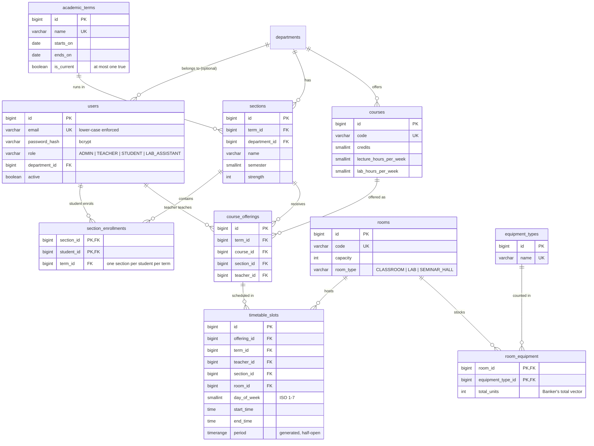

# ClassOS database schema

Source of truth: the Flyway migrations in `backend/src/main/resources/db/migration/`.
This document explains the design; if the two disagree, the SQL wins.

## ER diagram

## Key design decisions

**Conflicts are prevented by the database, not only by Java.** `timetable_slots` has three
exclusion constraints: no two slots in the same term may overlap for the same room, the
same teacher, or the same section. A check-then-insert in Java has a race window: two
concurrent requests can both see "free" and both insert. An exclusion constraint closes
that window regardless of how many requests or backend instances run in parallel. This
needs the `btree_gist` extension, which is why it is the first line of the migration.

**Half-open time ranges `[start, end)`.** A 09:00–10:00 class and a 10:00–11:00 class
do not conflict. With closed ranges they would, and back-to-back scheduling would fail.

**Copied columns protected by composite foreign keys.** `timetable_slots` stores
`teacher_id`, `section_id` and `term_id` even though they are derivable from the offering,
because exclusion constraints can only use columns of their own table. Normally that
copying risks inconsistency; here the composite FK
`(offering_id, term_id, teacher_id, section_id) → course_offerings` makes a mismatched copy
impossible, and `ON UPDATE CASCADE` propagates a teacher reassignment to every slot. If the
new teacher is busy at any of those times, the whole update is rejected.

**Role checks across tables use a trigger.** "Only a TEACHER may teach an offering" refers
to another table, which a CHECK constraint cannot do. The `enforce_user_role` trigger
handles it. Known limitation: changing a user's role afterwards is not re-validated.

**Roles stored as `VARCHAR` + `CHECK`, not a PostgreSQL `ENUM`.** Both enforce valid values;
the VARCHAR form maps directly to a Java enum with `@Enumerated(EnumType.STRING)` and is
easier to extend with a migration.

**What is deliberately not a constraint.** Room capacity vs. section strength, LAB slots in
LAB rooms, daily teaching-hour limits and lunch breaks are rules the timetable engine
(Milestone 2) checks, because real timetables have legitimate exceptions to them.

## Planned tables (later migrations)

| Migration | Milestone | Tables | Key constraint ideas |
|-----------|-----------|--------|----------------------|
| V2 (done) | 2 | `period_slots`, `teacher_unavailability`, `timetable_runs`, `room_bookings`; `source`/`locked` on slots | exclusion per room and date for bookings; see `docs/concurrency.md` |
| V5 (done) | 5 | `feedback`, `sus_responses` | one SUS response per user; answers checked to be ten values from 1 to 5 |
| later | — | `equipment_claims` | declared max claim per lab session for the Banker's allocator |
| V3 (done) | 3 | `class_sessions`, `student_devices`, `attendance_records`, `attendance_attempts` | one record per student per session; one device per student and per session; one open session per offering and per teacher; see `docs/attendance.md` |
| V4 (done) | 4 | `stored_files`, `materials`, `assignments`, `submissions` | one submission per student per assignment; `version` for optimistic locking on grades; marks ≤ maximum (trigger); partial index on waiting submissions |

Weekly slots and dated bookings live in different tables, so no single constraint can stop
a booking that clashes with a weekly class. V2 resolves this with a row lock on the room;
see `docs/concurrency.md`.
